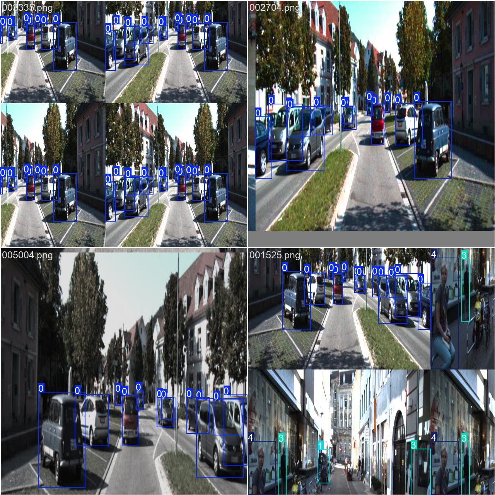

# Разработка нейросетевой системы детекции объектов дорожной сцены с использованием архитектур YOLO и RT-DETR

## 1. Введение
Для того чтобы беспилотные автомобили могли безопасно ездить, они должны отлично "видеть" и понимать, что происходит на дороге. В этой работе проводится бенчмаркинг двух современных архитектур: скоростного семейства YOLO и высокоточной трансформерной модели RT-DETR. Разработка выполнена в подсистеме Linux (WSL) для приближения процесса к реальным индустриальным стандартам.

## 2. Актуальность и Цель
Нейросеть в машине должна работать не только без ошибок, но и максимально быстро. 
**Цель работы:** Собрать систему распознавания объектов дорожной сцены, сравнить 5 моделей по точности (mAP) и скорости работы (FPS)

## 3. Набор данных (KITTI 2D Object Detection)
В качестве экспериментальной базы использовался датасет KITTI.
* **Классы объектов:** `car`, `van`, `truck`, `pedestrian`, `person_sitting`, `cyclist`, `tram`, `misc`.
* **Формат разметки:** Нормализованный формат YOLO (`.txt`).
* **Особенности:** Сбор данных в реальных дорожных условиях, высокая сложность сцен (плотный трафик, перекрытие объектов, мелкие элементы), разделение объектов на 3 уровня сложности для объективной оценки.

## 4. Настройки обучения для всех моделей
* epochs = 50   - Кол-во шагов(проходов) нейросети по обучающим данным
* imgsz = 640   - Размер изображения в пикселях до которого сеть сжимает фото перед обработкой
* batch = 16    - Число изображений, которые обрабатываются за 1 шаг
* device = 0    - Выбор вычислительного устройства (использование GPU для ускорения)
* patience = 10 - "Ранняя остановка", то есть обучение остановится само если точность перестанет расти в течение 10 эпох

## 5. Использованные архитектуры
* YOLOv5
* YOLOv8
* YOLOv10
* YOLOv11
* RE-DETR

## 6. Результаты обучения

| Архитектура модели | mAP@50 | mAP@50-95 | Время инференса |
| :--- | :--- | :--- | :--- |
| **RT-DETR-l** | **0.898** | **0.649** | 8.1 ms |
| **YOLOv8n** | 0.640 | 0.398 | **0.5 ms** |
| **YOLO11n** | 0.607 | 0.381 | 0.7 ms |
| **YOLOv5nu** | 0.601 | 0.370 | 0.6 ms |
| **YOLOv10n** | 0.548 | 0.347 | 0.7 ms |

## 7. Графики результатов
* YOLOv8[YOLOv8](runs/detect/runs/detect/yolov8_kitti-2/results.png)
* YOLOv10[YOLOv10](runs/detect/runs/detect/yolov10_kitti-2/results.png)
* YOLOv11[YOLOv11](runs/detect/runs/detect/yolo11_kitti/results.png)
* RE-DETR[RE-DETR](runs/detect/runs/detect/rtdetr_kitti/results.png)

## 7. Вывод
Трансформер **RT-DETR-l** является абсолютным лидером по точности (mAP@50 = 0.898) и лучше всего справляется со сложными сценами, но требует больше ресурсов. Модели **YOLOv8** и **YOLO11** показывают отличную скорость (0.5–0.7 мс на кадр), что делает их оптимальным выбором для развертывания на устройствах с ограниченной вычислительной мощностью.